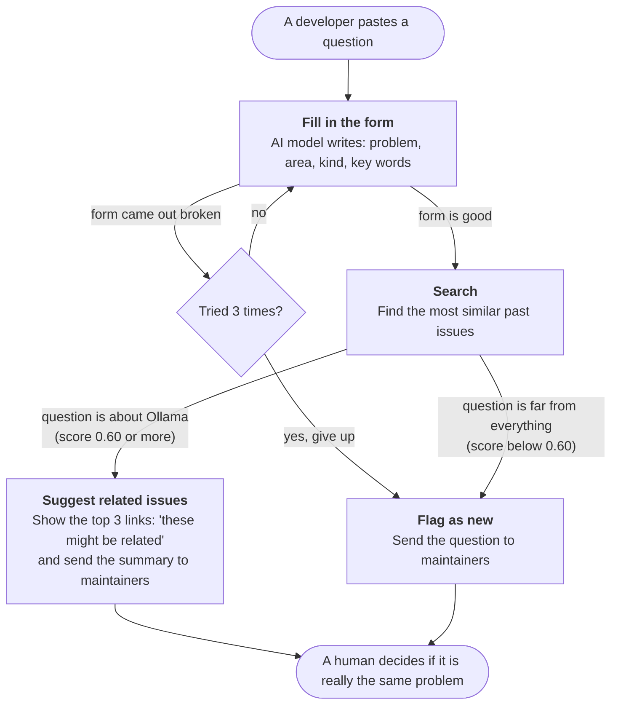

# Community Triage Bot on Open Models

[](https://github.com/krutik-2-11/triage-bot/actions/workflows/tests.yml)

A small bot that reads a developer's question and either **suggests related existing issues** or **flags it as new** for maintainers, with a short structured summary. It runs fully on a laptop with small open models through [Ollama](https://ollama.com), and it is tested on real issues from the [ollama/ollama](https://github.com/ollama/ollama) GitHub repo.

Built with LangChain, LangGraph, Pydantic and Ollama.

> This is a small experiment, not a production-grade bot. It is tested on 49 labeled pairs from one repo, on one laptop. Its value is the method and what broke, not the exact numbers.

## The problem

Developer communities get the same question in many different words. That causes three problems:

- **The person asking** waits for an answer that already exists in an old thread.
- **Maintainers and DevRel teams** answer the same thing again and again.
- **Product teams** miss a demand signal: ten posts about one problem look like ten small problems.

This bot sits at the front door. When a question comes in, it points to related threads or flags the question as new.

## Who it helps

| Who | What they get |
|---|---|
| **The person asking** | Links to existing threads right away, instead of waiting for a reply |
| **Maintainers and DevRel teams** | A one-line summary with area and kind, so they can sort new questions fast |
| **Product teams** | A count of questions by area and kind. Many posts about one need show up as one group |

Where it could sit: the front door of a GitHub "new issue" form, a Discord or Slack help channel, or a community forum. It runs locally, so community text does not leave the machine.

**Design rule: suggest, don't close.** The bot never says "this is a duplicate." It says "this might be related," and a person makes the final call. A wrong "duplicate" label feels dismissive to the person asking.

## How it works



1. **Fill in the form.** A small chat model (`qwen3.5:4b`) reads the question and returns a fixed form: `pain_point`, `area`, `kind`, `key_terms`. Pydantic checks the form. If it is broken, the bot tries again, up to 3 times.
2. **Search.** An embedding model (`nomic-embed-text`) turns text into a list of 768 numbers. The bot compares the question against every past issue and ranks them by cosine similarity.
3. **Route.** If the question is on topic, the bot shows the top 3 related issues and sends the summary to maintainers. If not, it flags the question as new.
4. **No question is dropped.** If the form fails 3 times, the bot skips search, logs the error to `logs/failures.jsonl`, and still sends the original question to maintainers.

Why a graph and not a simple chain: a chain only goes forward. This bot needs a loop (retry) and a branch (suggest or flag). LangGraph makes both visible and testable. To print the graph LangGraph builds from the code:

```bash
uv run python triage_graph.py --show-graph
```

## Quickstart

You need macOS or Linux, the [Ollama app](https://ollama.com/download), [uv](https://docs.astral.sh/uv/), and a read-only GitHub token (public repos only).

**1. Install and pull the models**

```bash
git clone https://github.com/krutik-2-11/triage-bot.git && cd triage-bot
uv sync
ollama pull nomic-embed-text && ollama pull qwen3.5:4b
```

**2. Download the issues** (about 1,100 issues; the data stays on your machine and is not committed)

```bash
echo "GITHUB_TOKEN=your_token_here" > .env
uv run --env-file .env python fetch_issues.py
```

**3. Run the bot**

Ask your own question (put it in quotes):

```bash
uv run python triage_graph.py "Ollama won't use my GPU on Ubuntu 24.04. I have an RTX 3060 and the driver is installed."
```

You should see something like this:

```
Q: Ollama won't use my GPU on Ubuntu 24.04. I have an RTX 3060 and the driver is installed.
route=suggest_related  attempts=1  top_score=0.847  5.3s
This might be related to existing issues:
  #16063 Ollama not running on the GPU (Bazzite, brew) (0.85)
    https://github.com/ollama/ollama/issues/16063
  #15801 Ubuntu and ollama (0.85)
    https://github.com/ollama/ollama/issues/15801
  #16690 Ollama gemma does not run on GPU Radeon 890M anymore after v 0.24.0 (0.82)
    https://github.com/ollama/ollama/issues/16690
If none of these match, a maintainer will take a look.
```

The first run takes longer because the model loads. Your issue numbers and scores may differ, because the downloaded issues change over time.

Other ways to run it:

| Command | What it does |
|---|---|
| `uv run python triage_graph.py` | Runs one sample question |
| `uv run python triage_graph.py --demo` | Runs all 5 sample questions, including one off-topic question |
| `uv run python triage_graph.py --show-graph` | Prints the graph as a Mermaid diagram |

Other commands:

| Command | What it does |
|---|---|
| `uv run python build_index.py` | Scores search quality on the labeled duplicate pairs |
| `uv run python calibrate_threshold.py` | Tests which similarity score separates duplicates from non-duplicates |
| `uv run python compare_models.py` | Runs the 3-model comparison (pull the 3 chat models first, see below) |
| `uv run pytest -v` | Runs the tests (no Ollama needed) |

## Results

### The test set

`fetch_issues.py` found closed issues where a maintainer wrote **"Duplicate of #N"** in a comment. Those are the answer key: **49 duplicate pairs**. It added **1,000 normal closed issues** as distractors, so the right answer has to be found among many wrong ones. Total: **1,094 issues**.

Two rules keep the test fair:

- **No peeking at the future.** For each duplicate, the bot searches only issues created before it.
- **No leaked answers.** The "Duplicate of #N" text lives in comments, and only titles and bodies are used. Issue numbers are also removed from the text before search.

### Search quality

| Embedding model | Recall@1 | Recall@5 | MRR | Time to embed 1,094 issues |
|---|---|---|---|---|
| **nomic-embed-text** (chosen) | 0.796 (39/49) | **0.898 (44/49)** | 0.843 | 26.7 s |
| qwen3-embedding:0.6b | 0.755 (37/49) | 0.878 (43/49) | 0.817 | 80.9 s |

- **Recall@5:** is the right issue in the top 5? This is the number that matters most, because the bot shows a short list.
- **Recall@1:** is it at the very top?
- **MRR:** how high it ranks on average (1.0 means always first).

On 49 pairs, a gap of 1 or 2 pairs is a tie. I picked `nomic-embed-text` because it was about 3 times faster and much smaller.

**Hand audit.** Maintainers don't label every duplicate. For the 10 cases where the bot's top answer was not the labeled one, I compared titles by hand. In 4 of them, the bot had found a real related report (for example, another report of the same bug). **Strict Recall@1 = 0.796; audited Recall@1 = 0.878.** Verdicts are in `results/audit_1.4.md`.

### Demo

On 5 sample questions, all summaries were valid on the first try, at about 2 seconds per question after the first one. The 4 Ollama questions were routed to `suggest_related`, and an off-topic question about sourdough bread scored 0.44 and was flagged as new.

## Model comparison (Phase 2)

Same 49 duplicate questions, same prompt and schema, temperature 0, reasoning off, same embedder (`nomic-embed-text`) and threshold (0.60). One chat model in memory at a time, with an untimed warm-up call first. MacBook Air M5, 16 GB, context 4096. Full results: [results/models.md](results/models.md).

| Model | Valid JSON 1st try | Retries | Median s / question | Memory at load* | Memory after 49 q* | `kind` correct** | `area` correct** |
|---|---|---|---|---|---|---|---|
| `qwen3.5:4b` | 49/49 | 0 | 2.9 | ≈3.9 GB | ≈10 GB | 8/9 | 9/10 |
| `gemma4:e4b-it-qat` | 49/49 | 0 | 3.4 | ≈4.1 GB | not measured | 9/9 | 10/10 |
| `nemotron-3-nano:4b` | 49/49 | 0 | 3.1 | ≈3.0 GB | ≈11 GB | 5/9 | 9/10 |

\* Change in macOS wired memory. `ollama ps` under-reported Gemma (261 MB), so I cross-checked all three. Ollama ran Qwen and Nemotron on MLX and Gemma on llama.cpp, so speed and memory reflect the model plus its runtime.
\** Random sample of 10 issues (seed 42), hand-labeled from titles only, one labeler; one `kind` was too ambiguous to judge. See [results/audit_2.3.md](results/audit_2.3.md).

Retrieval was identical for all three (suggest 47/49, original in top 3 43/49), which confirms only the chat model changed.

**Trade-offs I saw**

- **Form-filling didn't separate them.** All three gave valid JSON on the first try, 49/49. The retry loop never fired. With a JSON schema and temperature 0, structure is not the hard part.
- **Labels did.** Nemotron used the least memory at load, but called 26 of 49 issues "question" (vs 25–28 "bug" for the others) and got 5/9 `kind` right on the random sample. Product would count demand by these labels, so switching models changes the report.
- **Speed is a tie, memory over time is not.** Medians were within 0.5 s, and the order flipped between a 20-question and a 49-question run. But the two MLX models grew from ~3–4 GB to 10–11 GB after 49 questions (cause unproven). For a bot that runs all day, memory after many requests matters more than memory at load.

No winner: the right pick depends on whether you care most about label quality or memory.

To run it yourself:

```bash
ollama pull gemma4:e4b-it-qat && ollama pull nemotron-3-nano:4b
uv run python compare_models.py
```

## What I noticed

- **Ranking works, absolute scores don't.** I expected one similarity score to separate duplicates from non-duplicates. It doesn't. Normal issues scored higher with their closest neighbor (median 0.783) than true duplicates did with their original (median 0.759). In a repo about one product, every issue has a close "same topic" neighbor. So the 0.60 threshold is an **on-topic gate**, not a duplicate detector.
- **Sibling duplicates.** One bug often has many reports, but the maintainer links only one. The bot sometimes found a different report of the same bug.
- **Root-cause links.** Some maintainers linked issues by their hidden cause, not their wording. Text similarity can't see that. This is why the bot suggests and a human confirms.
- **Search finds the topic, not the answer.** I asked about running GPT-5.5 on Ollama. The bot suggested 3 "model not loading" issues, all around 0.73. The real answer (GPT-5.5 is a closed model and is not on Ollama) is in no past issue, so search can't find it. The summary also dropped the model name, the most useful clue for a maintainer. A maintainer still adds the knowledge.
- **Very short posts are hard.** A 4-word title gives the search little to work with.
- **Demand signal, live.** "Parallel requests," "more than one instance" and "Concurrency" were three wordings of one need.
- **Small-model labels are fuzzy.** The sourdough question got `area = cli` because the form has no "not about Ollama" option. A question about images got `gpu` instead of `model_support`.
- **Valid output isn't correct output.** In Phase 2, every model filled the form perfectly, but they disagreed on `kind` for 29 of 49 questions.

More in [NOTES.md](NOTES.md).

## Metrics worth tracking

**Measured in this repo (offline, with the answer key):**

| Metric | Question it answers | Current result |
|---|---|---|
| Recall@5 | Does the right thread make the suggestion list? | 0.898 (44/49) |
| Recall@1 and MRR | How high does it rank? | 0.796 and 0.843 |
| Valid form on first try | Can the model fill in the form reliably? | 49/49 for all 3 models |
| Retries needed | How often does the form break? | 0 for all 3 models |
| Seconds per question | Is it fast enough for a chat channel? | median 2.9 to 3.4 s |
| Memory over time | Will it fit a laptop all day? | grew to 10–11 GB after 49 questions (2 models) |
| Label accuracy (`kind`) | Can product trust the counts? | 5/9 to 9/9 on a random sample |
| Off-topic flagging | Does it stay quiet on unrelated posts? | sourdough scored 0.44 and was flagged |

**What I would measure in a pilot (not measured yet):**

| Metric | Why it matters |
|---|---|
| Time to first answer | The main benefit for the person asking |
| Suggestion click rate | Are the suggested links useful enough to open? |
| Maintainer confirm rate | When a maintainer reviews a suggestion, how often is it really the same problem? |
| "Wrong suggestion" reports | The cost side: suggestions that feel dismissive |
| Repeat questions per area | The demand signal for the product team |

These are hypotheses. I have no real-user data, so I make no claims about time saved.

## Limits

- **Small test set:** 49 labeled pairs from one repo. These numbers don't generalize to other communities.
- **Labels are incomplete:** some distractors are probably unlabeled duplicates, so some "misses" may be right.
- **The audits used titles only,** not full bodies, and one person did the labeling.
- **Long posts are cut at 2,000 characters** before search, so the end of long log dumps is not seen.
- **The threshold is an on-topic gate,** not a duplicate detector.
- **One machine, one run per model.** Speed gaps under a second are noise. Memory growth was seen but its cause is unproven.
- **No real-user data.** The business value is a hypothesis. In a pilot, I would measure time to first answer and how often people click a suggestion.
- **The label schema is too coarse for a one-product repo.** 8 of 10 random issues landed in `area = model_support`, which mixes download failures, new-model requests and bad output. There is no "not about Ollama" or "needs more info" option. I kept the schema fixed so the comparison stays fair; a next version would split these buckets and re-run. See [results/audit_2.3.md](results/audit_2.3.md).

## Tests and CI

The tests check my own logic, not the model's quality. They use a fake model and a fake search, so they run without Ollama, fast and the same way every time:

- the form rejects bad values
- the bot retries when the form breaks, and succeeds on the next try
- after 3 failures it flags the question as new, skips search and logs the error
- a high score routes to `suggest_related`, and a low score routes to `flag_new`

Model quality is measured separately, with the answer key above. GitHub Actions runs `uv run pytest` on every push.

## How I used Claude

I designed the evaluation: the answer key, leak checks, audits and the comparison rules. I wrote the code with Claude as a pair programmer, then ran, debugged and checked every step myself. NOTES.md records what I expected and what I got wrong.

## Project layout

```
fetch_issues.py          download issues and build the answer key
build_index.py           embed issues and score search quality
summarize_chain.py       LangChain: prompt + model + Pydantic form
triage_graph.py          LangGraph: retry, search, suggest or flag
calibrate_threshold.py   test similarity thresholds
compare_models.py        run the same 49 questions through 3 chat models
tests/test_triage.py     tests with a fake model and fake search
results/                 audits, model notes and compare.csv (issue numbers only)
NOTES.md                 what I expected and what I got wrong
data/                    downloaded issues and model summaries (not committed)
```

## Data and privacy

The issues are public, but their text belongs to their authors. The `data/` folder is in `.gitignore`, and this repo refers to issues by number only. `logs/` is ignored too, because it can hold the text of failed questions.

## Small open models or large closed models?

I only tested small open models. I did not run a closed-model baseline, so this section is reasoning, not a measured result.

| | Small open models, run locally | Large closed models (API) |
|---|---|---|
| **Data** | Stays on your machine | Sent to the provider |
| **Cost** | Hardware only, close to zero per question | Pay per question, grows with volume |
| **Quality** | Fine for structure, weaker on labels (this repo) | Likely better at judgment (not measured here) |
| **Control** | Version is fixed, so eval scores stay valid | The model can change under you |
| **Setup** | You manage memory, runtimes and updates | One API call |

**When to use which**
- **Small open, local:** private data (support tickets, internal forums), high volume, routine tasks like filling a form or ranking suggestions.
- **Large closed:** public data, low volume, or steps where judgment matters, like deciding whether two posts share a root cause, or labels that product will count.
- **Mix:** a small local model handles every question, and a larger model only reviews the hard or uncertain ones.

The right way to decide is to run a large model on the same 49 pairs and compare. That is the next step, not a claim.